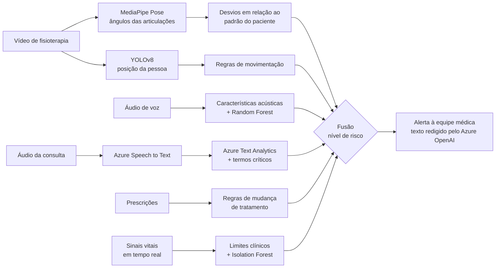

# Tech Challenge Fase 4 — Monitoramento multimodal de pacientes

Projeto da Fase 4 da pós-graduação IA para Devs (FIAP POSTECH).

O sistema analisa **vídeo, áudio, texto e sinais vitais** de um paciente, detecta anomalias em cada fonte,
combina os resultados em um nível de risco e emite um **alerta para a equipe médica**.

- Relatório técnico: [docs/RELATORIO_TECNICO.md](docs/RELATORIO_TECNICO.md)
- Vídeo de demonstração: _(link a incluir)_

## Como funciona



Cada módulo devolve uma lista de **eventos** (fonte, tipo, severidade de 1 a 3, instante e descrição).
A fusão soma a maior severidade de cada fonte:

| Pontuação | Nível | Alerta |
|---|---|---|
| 0 ou 1 | Baixo | Não |
| 2 a 4 | Médio | Sim |
| 5 ou mais, ou qualquer evento grave | Alto | Sim |

A decisão de alertar vem sempre dessas regras. O GPT apenas redige o texto do relatório, e se ele estiver
indisponível o alerta sai com um texto padrão.

## Tecnologias

| Dado | Técnica |
|---|---|
| Vídeo (postura) | MediaPipe Pose |
| Vídeo (detecção) | YOLOv8 (`ultralytics`) |
| Voz | `librosa` + Random Forest (`scikit-learn`) |
| Áudio da consulta | Azure Speech (Text to Speech e Speech to Text) |
| Texto | Azure Text Analytics (sentimento e frases-chave) + lista de termos críticos |
| Sinais vitais | Limites clínicos + Isolation Forest |
| Prescrições e movimentação | Regras explícitas |
| Relatório do alerta | Azure OpenAI (GPT) |

## Instalação

Requer Python 3.12.

```bash
python -m venv .venv
.venv\Scripts\Activate.ps1      # Windows, PowerShell (no Prompt de Comando: .venv\Scripts\activate.bat)
pip install -r requirements.txt
```

### Serviços Azure

O projeto usa três recursos: **Speech**, **Language** e **Azure OpenAI** (com um deployment de modelo GPT).

1. Crie os recursos no portal do Azure ou pela CLI (exemplo com tier gratuito para Speech e Language):

```bash
az group create -n rg-techchallenge-fase4 -l brazilsouth
az cognitiveservices account create -n <nome-speech> -g rg-techchallenge-fase4 --kind SpeechServices --sku F0 -l brazilsouth --yes
az cognitiveservices account create -n <nome-language> -g rg-techchallenge-fase4 --kind TextAnalytics --sku F0 -l brazilsouth --yes
az cognitiveservices account create -n <nome-openai> -g rg-techchallenge-fase4 --kind OpenAI --sku S0 -l brazilsouth --custom-domain <nome-openai> --yes
az cognitiveservices account deployment create -n <nome-openai> -g rg-techchallenge-fase4 --deployment-name gpt-4.1-mini --model-name gpt-4.1-mini --model-version 2025-04-14 --model-format OpenAI --sku-name GlobalStandard --sku-capacity 10
```

2. Copie `env.template.txt` para `.env` e preencha as chaves e os endereços. O `.env` não é versionado.
3. Confira a conexão:

```bash
python scripts/testar_azure.py
```

Saída esperada: uma linha `OK` para cada serviço.

## Como executar

### Demonstração do fluxo completo

O repositório já traz as amostras e os modelos necessários (`data/amostras/` e `models/`), então a demonstração
roda sem baixar os datasets.

```bash
python monitor.py --lista              # pacientes disponíveis
python monitor.py --paciente P001      # estável: nenhum alerta
python monitor.py --paciente P002      # risco médio que sobe para alto durante o monitoramento
python monitor.py --paciente P003      # vários sinais de piora: risco alto
```

Opções: `--velocidade 50` acelera a simulação dos sinais vitais (padrão: 20 vezes o tempo real; `0` = sem pausa)
e `--sem-gpt` redige o alerta com o texto padrão.

Os alertas ficam em `results/alertas.jsonl` e o vídeo com o esqueleto desenhado em `results/`.

Na primeira execução são baixados automaticamente os pesos do MediaPipe Pose e do YOLOv8 (cerca de 15 MB).

### Notebooks

| Notebook | Conteúdo |
|---|---|
| [01_audio_consulta](notebooks/01_audio_consulta.ipynb) | Síntese, transcrição e análise de texto com Azure |
| [02_voz_voiced](notebooks/02_voz_voiced.ipynb) | Classificador de alterações vocais |
| [03_video_fisioterapia](notebooks/03_video_fisioterapia.ipynb) | Postura, detecção e desvios de execução |
| [04_anomalias](notebooks/04_anomalias.ipynb) | Sinais vitais, prescrições e movimentação |
| [05_fluxo_completo](notebooks/05_fluxo_completo.ipynb) | Fusão e alerta para os três pacientes |

Os notebooks 02, 03 e 04 usam os datasets completos:

```bash
python scripts/baixar_dados.py voiced   # vozes (cerca de 30 MB)
python scripts/baixar_dados.py bidmc    # sinais vitais (cerca de 1 MB)
python scripts/baixar_dados.py rehab    # vídeos de fisioterapia (2,6 GB)
```

Os arquivos vão para `data/raw/` (fora do git). Use `--destino` para escolher outra pasta.

### Testes

```bash
pytest -q
```

São 98 testes. Os que chamam o Azure são pulados automaticamente quando não há arquivo `.env`.

## Estrutura

```
monitor.py              fluxo completo para um paciente
src/
  modelos.py            tipos compartilhados (Evento, Risco)
  config.py             leitura do .env
  video/                pose.py, detector.py, desvios.py
  audio/                sintese.py, transcricao.py, texto.py, voz.py
  anomalias/            sinais_vitais.py, prescricoes.py, movimentacao.py
  fusao/                risco.py, alerta.py, monitoramento.py
scripts/                testar_azure.py, baixar_dados.py
tests/                  testes automatizados
notebooks/              exploração e resultados de cada etapa
data/
  roteiros/             roteiros das consultas
  amostras/             áudios, vídeos e sinais usados na demonstração
  prescricoes.csv       tabela sintética de prescrições
  pacientes_demo.json   pacientes de demonstração
models/                 modelos treinados e padrão de execução do paciente
docs/                   relatório técnico
```

## Dados e limitações

| Dado | Origem | Observação |
|---|---|---|
| Vídeos de fisioterapia | [REHAB24-6](https://zenodo.org/records/13305826) | Černek, Sedmidubský e Budíková. Licença CC BY-NC 4.0. Os clipes em `data/amostras/` são recortes reduzidos desse dataset |
| Gravações de voz | [VOICED](https://physionet.org/content/voiced/) (PhysioNet) | Vogal "a" sustentada, vozes saudáveis e patológicas |
| Sinais vitais | [BIDMC](https://physionet.org/content/bidmc/) (PhysioNet) | Pacientes de UTI. Não traz pressão arterial: a pressão é **simulada** |
| Áudios de consulta | Roteiros próprios + Azure Text to Speech | **Sintéticos** |
| Prescrições | Tabela própria | **Sintética** |

Este é um projeto acadêmico. Não é um dispositivo médico e não deve ser usado para decisões clínicas reais.
As limitações de cada módulo estão descritas no relatório técnico.
