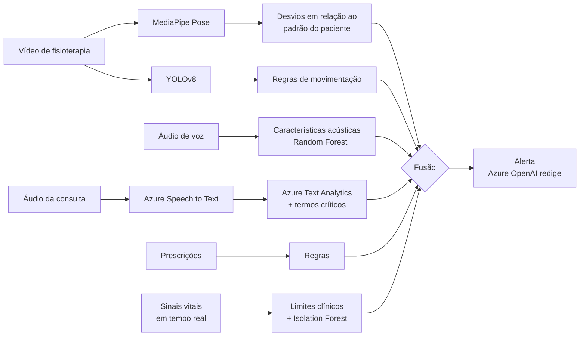
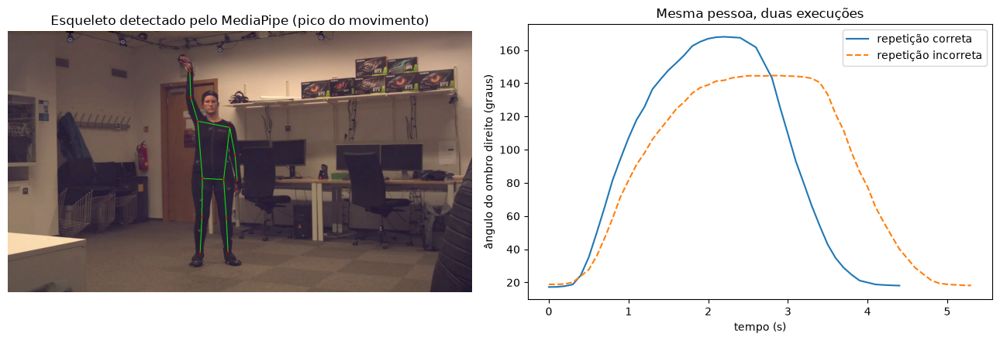
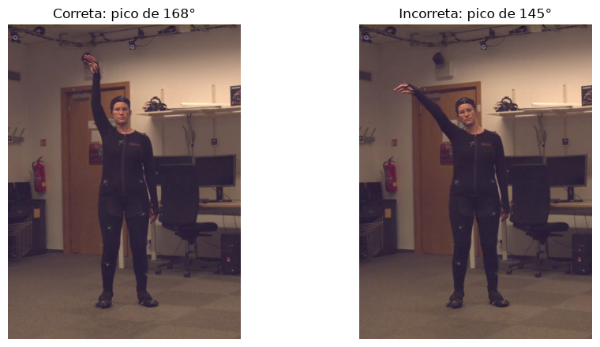
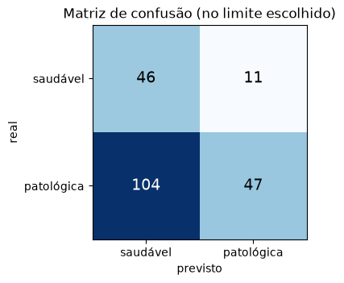
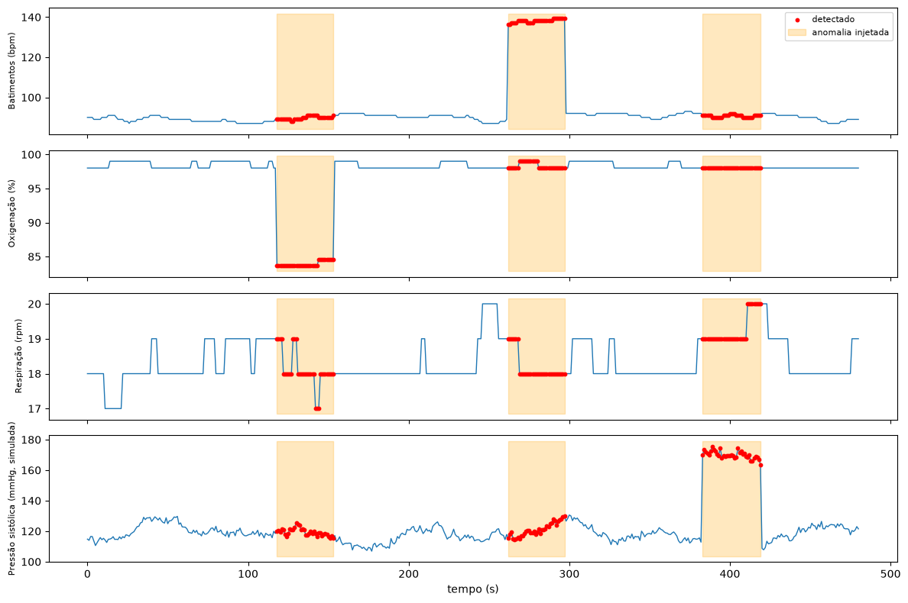

# Relatório técnico — Tech Challenge Fase 4

Monitoramento multimodal de pacientes: análise de vídeo, áudio, texto e sinais vitais com detecção de anomalias
e alerta à equipe médica.

## 1. Objetivo

O hospital quer acompanhar continuamente os pacientes por dados multimodais e identificar sinais precoces de risco.
O sistema desenvolvido:

1. Analisa vídeos de sessões de fisioterapia e aponta execuções fora do padrão.
2. Processa áudios de consulta (transcrição, sentimento, termos críticos) e gravações de voz (alterações vocais).
3. Detecta anomalias em sinais vitais, prescrições e movimentação do paciente.
4. Funde tudo em um nível de risco por paciente e emite o alerta, usando serviços gerenciados do Azure.

## 2. Fluxo multimodal

### 2.1 O evento como linguagem comum

Cada módulo analisa um tipo de dado e devolve uma lista de **eventos** com o mesmo formato:

| Campo | Significado |
|---|---|
| `fonte` | `video`, `voz`, `texto`, `sinais_vitais`, `prescricao`, `movimentacao` ou `sensor` |
| `tipo` | Por exemplo `termo_critico`, `amplitude_fora_do_esperado`, `limite_clinico` |
| `severidade` | 1 (leve), 2 (moderada) ou 3 (grave) |
| `instante` | Segundos desde o início do dado analisado |
| `descricao` | Frase legível, usada no alerta |

É esse formato único que permite juntar fontes tão diferentes.

### 2.2 Fusão e nível de risco

1. De cada fonte vale apenas o evento mais grave.
2. A pontuação é a soma dessas severidades.
3. **Alto:** pontuação 5 ou mais, ou qualquer evento de severidade 3. **Médio:** pontuação de 2 a 4. **Baixo:** 0 ou 1.

Consequências práticas:

- Um indício leve isolado (por exemplo, só a voz) não gera alerta.
- Vários indícios moderados em fontes diferentes somam e geram alerta.
- Um único evento grave, como oxigenação abaixo do limite clínico, já gera alerta de risco alto.
- Falha de sensor é registrada, mas não entra na pontuação (é problema do equipamento, não do paciente).

### 2.3 Alerta

Quando o risco é médio ou alto, o sistema grava o alerta em `results/alertas.jsonl`, mostra no terminal e pede ao
**Azure OpenAI** (modelo GPT) a redação de um relatório curto. O GPT recebe só os eventos e o nível de risco, com
instrução para não diagnosticar nem sugerir medicação. A decisão de alertar nunca é do GPT. Se o serviço falhar,
o alerta sai com um texto padrão.

Durante o monitoramento dos sinais vitais, o risco é recalculado a cada evento novo e um novo alerta só é emitido
quando o nível **sobe**, para não repetir o mesmo aviso.

### 2.4 Serviços Azure utilizados

| Serviço | Uso no projeto |
|---|---|
| Azure Speech — Text to Speech | Gera os áudios de consulta a partir dos roteiros |
| Azure Speech — Speech to Text | Transcreve os áudios de consulta |
| Azure Language — Text Analytics | Sentimento e frases-chave da transcrição |
| Azure OpenAI | Redação do relatório do alerta |

## 3. Modelos aplicados em cada tipo de dado

### 3.1 Vídeo

**Dados.** REHAB24-6: vídeos de 10 pessoas executando exercícios de reabilitação, com cada repetição rotulada por um
fisioterapeuta como correta ou incorreta. Usamos o exercício de abdução do braço direito, filmado de frente
(88 repetições de 8 pessoas).

**Análise postural: MediaPipe Pose.** Localiza 33 pontos do corpo em cada quadro. A partir deles calculamos 8 ângulos
(ombros, cotovelos, quadris e joelhos). O enunciado cita o OpenPose como exemplo; o MediaPipe Pose faz o mesmo trabalho
e foi a ferramenta estudada nas aulas.

**Detecção: YOLOv8.** O modelo pré-treinado localiza a pessoa no quadro. Guardamos o centro e o tamanho da caixa
(a maior, quando há mais de uma pessoa) e o número de pessoas. Essa trajetória alimenta as regras de movimentação.

**Detecção de desvios: padrão individual do paciente.** O padrão de execução é aprendido de duas repetições corretas
do próprio paciente (as feitas sob supervisão). Cada nova execução é comparada por dois critérios:

1. Algum ângulo ficou fora da faixa habitual do paciente por mais de 0,3 s?
2. O pico do movimento (ângulo máximo do ombro) ficou abaixo ou acima do habitual?

### 3.2 Voz

**Dados.** VOICED (PhysioNet): 208 gravações da vogal "a" sustentada por cerca de 5 s, a 8 kHz
(57 vozes saudáveis e 151 patológicas).

**Modelo.** Cada gravação é resumida em 20 características acústicas com `librosa`: frequência fundamental (média e
desvio), jitter (instabilidade da frequência), shimmer (instabilidade do volume), proporção vozeada, energia, taxa de
cruzamentos por zero e 13 MFCCs. Um Random Forest com classes balanceadas separa voz saudável de patológica, avaliado
por validação cruzada estratificada em 5 partes.

### 3.3 Áudio de consulta e texto

**Dados.** Quatro roteiros de fala de paciente, convertidos em áudio com o Azure Text to Speech. São áudios
**sintéticos**: não há dataset público de consultas médicas em português.

**Modelos.** O Azure Speech to Text transcreve o áudio (reconhecimento contínuo, que percorre o arquivo inteiro).
Sobre a transcrição:

- O **Azure Text Analytics** devolve o sentimento e as frases-chave. Sentimento negativo acima de 60% vira um evento leve.
- Uma **lista de 15 termos críticos** (por exemplo "falta de ar", "dor no peito", "tontura"), cada um com sua
  severidade, é procurada no texto ignorando maiúsculas e acentos.

### 3.4 Sinais vitais

**Dados.** BIDMC (PhysioNet): 53 pacientes de UTI, 8 minutos cada, uma leitura por segundo de batimentos, oxigenação
e frequência respiratória. O dataset não traz pressão arterial, então a pressão sistólica é **simulada**.

**Modelo.** Duas verificações combinadas, avaliadas a cada leitura:

1. **Limites clínicos** (evento grave): oxigenação abaixo de 88%, batimentos abaixo de 40 ou acima de 140,
   pressão sistólica acima de 180.
2. **Isolation Forest**, um modelo por sinal. Cada modelo olha o valor atual e o desvio em relação à mediana dos
   últimos 120 s do próprio paciente, para acusar tanto valores raros quanto mudanças bruscas.

Um episódio contínuo gera um único evento. Leituras ausentes ou zeradas viram um evento da fonte `sensor`.

### 3.5 Prescrições e movimentação

Usam **regras explícitas**: há poucos registros por paciente para treinar um modelo, e a equipe precisa saber
exatamente o motivo do alerta.

| Dado | Regra | Severidade |
|---|---|---|
| Prescrições | Variação de dose acima de 50% entre prescrições seguidas do mesmo medicamento | 2 (3 se a dose mais que dobrou) |
| Prescrições | Dois ou mais medicamentos novos iniciados em menos de 24 h | 2 |
| Movimentação | Paciente sem se deslocar por mais de 10 s | 2 |
| Movimentação | Centro da pessoa fora da área esperada do quadro | 2 |
| Movimentação | Ninguém no quadro por mais de 5 s | 2 |

As prescrições são uma tabela **sintética** com três pacientes.

## 4. Resultados

### 4.1 Vídeo

| Abordagem | Execuções incorretas detectadas | Falsos alarmes em execuções corretas |
|---|---|---|
| Padrão único para todas as pessoas | 0 de 15 (0%) | 0 de 16 (0%) |
| **Padrão individual do paciente (adotada)** | **31 de 41 (76%)** | **5 de 31 (16%)** |

A primeira abordagem não funcionou porque cada pessoa executa o exercício corretamente com uma amplitude diferente
(picos de cerca de 110° a 170°). Uma faixa que aceite todas fica larga demais e aceita qualquer execução.

### 4.2 Voz

| Métrica (validação cruzada) | Valor |
|---|---|
| AUC | 0,61 |
| Limite de decisão escolhido | 0,72 |
| Recall da classe patológica | 31% |
| Precisão da classe patológica | 81% |
| Falsos alarmes em vozes saudáveis | 19% |

A separação é **fraca**. Testamos mais características (variação dos MFCCs, relação harmônico-ruído, centroide
espectral) e outros modelos (regressão logística, SVM), e a AUC ficou sempre entre 0,60 e 0,67. Com o limite padrão
de 0,5, o modelo apontava 68% das vozes saudáveis como alteradas. Por isso:

- o limite é escolhido automaticamente como o menor que mantém os falsos alarmes em até 20%;
- o evento de voz tem severidade 1 e só pesa no risco quando aparece junto com outras fontes.

### 4.3 Áudio de consulta e texto

| Consulta | Transcrição igual ao roteiro | Sentimento (Azure) | Termos críticos |
|---|---|---|---|
| Rotina | 100% | Positivo | Nenhum |
| Cansaço | 100% | Misto (72% negativo) | cansaço, fadiga, insônia |
| Falta de ar | 100% | Negativo (100%) | falta de ar, dor no peito, palpitação |
| Medicação | 100% | Negativo (99%) | tontura, confusão, fraqueza |

### 4.4 Sinais vitais

Como o BIDMC não tem rótulo de anomalia, injetamos anomalias artificiais em posições conhecidas (queda de oxigenação,
taquicardia e pico de pressão, de 20 a 40 s cada). Treino com 40 pacientes; teste com os outros 13 (6.253 leituras,
1.179 delas anômalas).

| Métrica | Valor |
|---|---|
| Recall | 100% |
| Precisão | 65,5% |
| F1 | 79% |
| Precisão sem o paciente que fica fora dos limites clínicos | 82,5% |

Um único paciente de teste responde por 390 dos 621 segundos de "falso alarme": a oxigenação dele fica em 86% quase o
tempo todo, abaixo do limite clínico. Para o sistema, é um alarme legítimo.

Um único Isolation Forest com todos os sinais juntos, a primeira versão, tinha recall de apenas 34%: a alteração em um
sinal ficava diluída entre os demais. Um modelo por sinal resolveu isso e ainda informa qual sinal disparou.

### 4.5 Exemplos de anomalias detectadas

| Fonte | Exemplo de evento gerado |
|---|---|
| Vídeo | Amplitude de ombro_dir abaixo do esperado: pico de 145° (esperado entre 154° e 185°) |
| Voz | Características da voz compatíveis com alteração vocal (92%) |
| Texto | Paciente mencionou "falta de ar" na consulta |
| Texto | Sentimento negativo na fala do paciente (72%) |
| Sinais vitais | Sinais vitais fora do padrão (SPO2). Leituras: FC 89 bpm, SPO2 84 %, FR 19 rpm, PAS 120 mmHg |
| Sinais vitais | Sinais vitais fora do padrão (FC). Leituras: FC 136 bpm, SPO2 98 %, FR 19 rpm, PAS 116 mmHg |
| Prescrição | Dose de morfina passou de 5 mg para 15 mg (200% de variação) |
| Prescrição | Medicamentos novos iniciados em menos de 24 h: amiodarona e varfarina |
| Movimentação | Paciente sem se mover por 14 s |

### 4.6 Fluxo completo: três pacientes

| Paciente | Eventos antes dos sinais vitais | Durante os sinais vitais | Alertas |
|---|---|---|---|
| P001 | Nenhum | Nenhum | Nenhum (risco baixo) |
| P002 | Termos leves e sentimento negativo na consulta; aumento de 100% na dose de furosemida | Oxigenação cai para 84% aos 118 s | Médio (pontuação 3), depois alto (pontuação 6) no instante da queda |
| P003 | Amplitude insuficiente no vídeo; voz alterada; "falta de ar" e "dor no peito"; dose de morfina triplicada e dois medicamentos novos | Três episódios registrados | Alto (pontuação 9) antes dos sinais vitais |

Exemplo de relatório redigido pelo GPT para o segundo alerta do P002:

> Paciente P002 apresenta risco ALTO (pontuação 6). Foram detectados sinais vitais fora do padrão, com SpO2 em 84%, indicando possível comprometimento respiratório. Houve aumento significativo da dose de furosemida de 40 mg para 80 mg. O paciente relatou sintomas de cansaço, fadiga e insônia, além de expressar sentimento negativo na fala. Recomenda-se avaliação imediata pela equipe médica para monitoramento e ajuste do tratamento conforme necessário.

O texto completo de cada alerta fica em `results/alertas.jsonl` e no notebook 05.

## 5. Limitações

- **Áudios de consulta sintéticos.** A transcrição perfeita reflete fala limpa de voz sintética; com gravações reais,
  ruído e sotaques, o resultado seria pior.
- **Voz.** O classificador é fraco (AUC 0,61) e o dado é uma vogal isolada, não fala de consulta. Fadiga e disartria,
  citadas no enunciado, exigiriam datasets de fala contínua que não encontramos com acesso aberto.
- **Vídeo.** Avaliamos um único exercício, visto de frente. Erros que não mudam os ângulos nessa vista passam
  despercebidos. O padrão individual usa só duas repetições de referência, e os parâmetros (margem de 10° e tolerância
  de 15°) foram escolhidos olhando os mesmos dados usados na avaliação.
- **Sinais vitais.** A pressão arterial é simulada e as anomalias são artificiais. A variante do detector foi escolhida
  olhando os mesmos 13 pacientes de teste, então as métricas são um pouco otimistas.
- **Prescrições e movimentação.** Dados sintéticos e regras simples; as regras de movimentação foram demonstradas com
  uma trajetória simulada.
- **Tempo real.** É simulado: as leituras de um arquivo são percorridas uma a uma, sem fila de mensagens nem sensores.
- **Uso.** Projeto acadêmico. Não é um dispositivo médico.

## 6. Como reproduzir

As instruções de instalação, configuração do Azure e execução estão no [README](../README.md). Os resultados deste
relatório estão nos notebooks de `notebooks/`, já executados.
